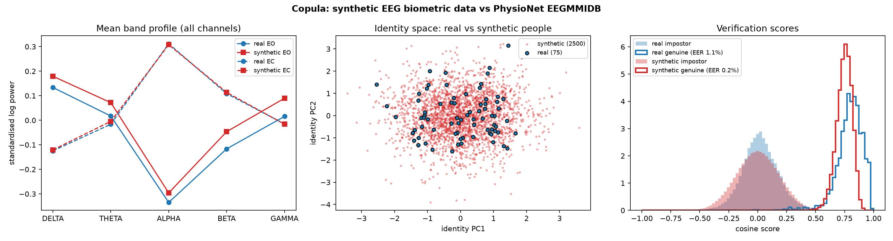
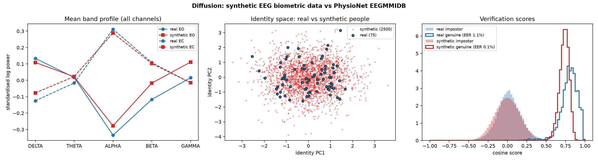
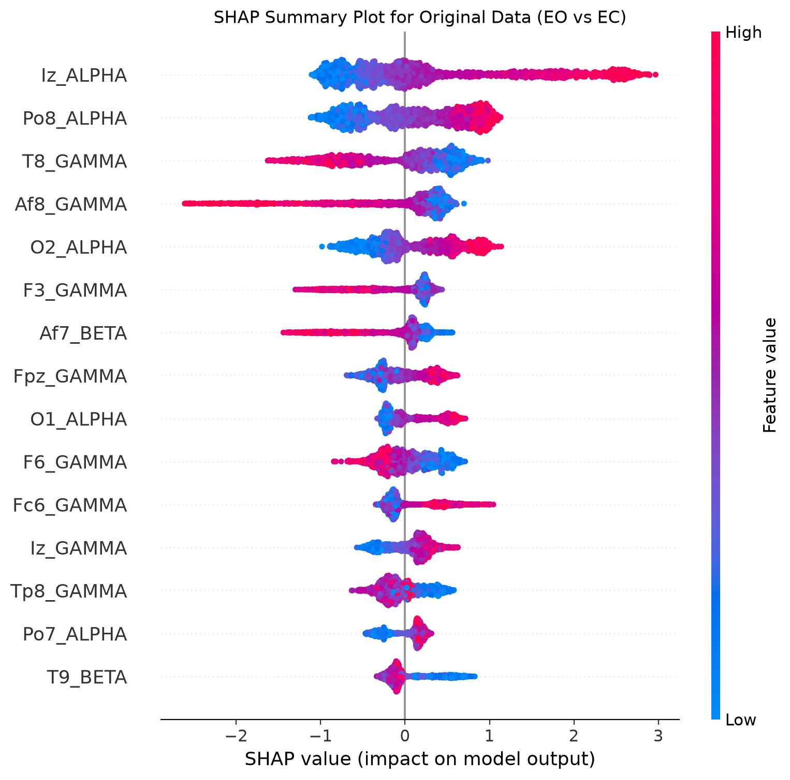
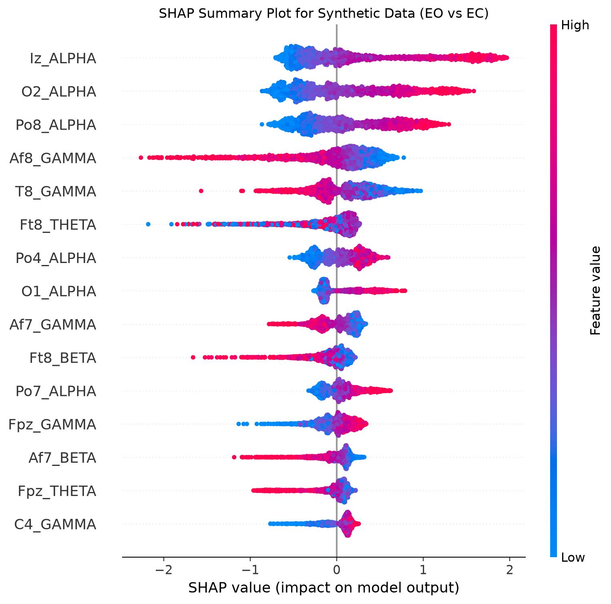

# Synthetic EEG Biometric Data Generation (VAE · GAN · Diffusion · LSTM · Copula)
### 2,500 synthetic individuals generated from the public PhysioNet EEG dataset

This is an adaptation of
[SeyedMuhammadHosseinMousavi/Synthetic-Data-Generation-Algorithms](https://github.com/SeyedMuhammadHosseinMousavi/Synthetic-Data-Generation-Algorithms)
(CC0). The original used a small excerpt of the **Brainwave EEG Dataset (BED)**, which is not publicly
available, for 4-class *emotion* recognition. This version:

* uses the **public PhysioNet EEG Motor Movement/Imagery Dataset (EEGMMIDB)**, with 109 subjects, 64 channels and 160 Hz.
  It is free and needs no registration. It is downloaded automatically.
* changes the task to **biometric authentication**: the label is *who* the person is.
* generates EEG feature data for **2,500 new, synthetic individuals**, far more than the 109 real ones.
* keeps the same five generator families as the original (VAE, GAN, Diffusion, LSTM and Gaussian Copula),
  re-implemented in PyTorch.
* evaluates with **biometric metrics** (EER, rank-1, train-on-synthetic/test-on-real, privacy). The
  original's XGBoost + SHAP top-10 feature-similarity analysis is kept too.

The original BED-based scripts are kept unchanged in [`original_BED_version/`](original_BED_version/).

---

## 1. Dataset: PhysioNet EEGMMIDB

| | |
|---|---|
| Source | https://physionet.org/content/eegmmidb/1.0.0/ |
| Licence | Open Data Commons Attribution v1.0 |
| Subjects | 109 |
| Recording | 64 EEG channels (10-10 system, BCI2000), 160 Hz, EDF+ |
| Runs used | **R01** 1 min resting, eyes **open** (EO) · **R02** 1 min resting, eyes **closed** (EC) |

Resting-state EO/EC recordings are the standard protocol for EEG biometrics on this dataset. Add task
runs with `A_download_physionet_eeg.py --runs ...` and `config.RUNS` if you want more windows per person.

**Citation** (required by PhysioNet):
> Schalk G, McFarland DJ, Hinterberger T, Birbaumer N, Wolpaw JR. *BCI2000: A General-Purpose Brain-Computer
> Interface (BCI) System.* IEEE TBME 51(6):1034-1043, 2004.
> Goldberger AL, et al. *PhysioBank, PhysioToolkit, and PhysioNet.* Circulation 101(23):e215-e220, 2000.

### Feature extraction (`B_extract_biometric_features.py`)
1. Band-pass filter 1-45 Hz, then common average reference.
2. Cut 2 s windows with a 1 s hop. Reject windows over 800 µV peak-to-peak (gross artifacts only).
3. Compute a Welch PSD, then **log10 band power** in δ (1-4), θ (4-8), α (8-13), β (13-30) and γ (30-45 Hz).
4. That gives **320 features** (64 channels × 5 bands) with names like `Fc5_ALPHA` or `O1_THETA`, the same style as the
   original's `AF3_THETA`.

The result is 12,408 windows from 109 subjects. Subjects with fewer than 10 clean windows in a state are excluded.

---

## 2. How 2,500 *new* people are generated

In the original, a generator conditioned on a class label can only reproduce the classes it has seen.
With identity as the label, that would mean only the 109 real people. To create new people, each EEG
window is modelled hierarchically:

```
x  =  μ(person, state)  +  r          r = within-person variability of one window
```

1. **Identity model** (`eegsyn/identity.py`)
   * Each real person is summarised by a prototype: the mean EO features and the mean EC features (640 dims).
   * Whitened PCA of the prototypes gives a 32-dim **identity code** `c ~ N(0, I)` (about 97 % of
     between-person variance).
   * To make a new person, sample a new code `c`, decode it to a prototype, and add a fixed person-specific
     detail term drawn from the variance PCA does not explain.
   * A **privacy filter** rejects any code closer to a real person than the 5th percentile of real-to-real
     nearest-neighbour distances.
2. **Within-person generator** (`eegsyn/generators.py`): one of the five models learns `p(r | c, state)`.

| # | Script | Model | Changes vs. the BED version |
|---|---|---|---|
| 0 | `0_VAE_Synthetic_Data_Generation.py` | Conditional VAE | Gaussian (MSE) likelihood instead of BCE; learned decoder noise |
| 1 | `1_GAN_Synthetic_Data_Generation.py` | Conditional WGAN-GP | Gradient-penalty critic, which is much more stable on 320-dim tabular data |
| 2 | `2_Diffusion_Model_Synthetic_Data_Generation.py` | DDPM | A real 200-step cosine-schedule diffusion model (the original was a one-step denoiser) |
| 3 | `3_VLSTM_Synthetic_Data_Generation.py` | Variational LSTM | Sequence VAE that walks the 64 electrodes, emitting 5 band powers per step |
| 4 | `4_Copula_Gaussian_Synthetic_Data_Generation.py` | Gaussian copula | Copula over [identity code, residual] with an exact conditional sampler; no extra package |

During training, identity codes get small Gaussian jitter so the networks generalise to unseen codes.

**Output per model:** 2,500 identities × 2 states × 20 windows = **100,000 windows**, saved to
`Outputs/<Model>/<Model>_Synthetic_EEG_2500_Identities.csv` (and `.npz`) with columns
`Fc5_DELTA … Iz_GAMMA, Subject (SYN0001…SYN2500), State (EO/EC), Window`.
Values are in the same units as the real feature table (log10 µV²/Hz).

---

## 3. Evaluation protocol

The generators are fitted on **70 % of the real subjects only**. The other 30 % are never seen and are
used to test utility. For a final release, use `--fit-all-subjects` to train on all subjects.

| Aspect | Metric |
|---|---|
| **Biometric quality** | Closed-set **EER** and **rank-1** among the synthetic people vs among real people. The LDA template is fitted on the first half of each recording; enrol and probe on the second half, split by time to avoid window-overlap leakage |
| **Utility (TSTR)** | An LDA embedding is trained on (a) real train subjects, (b) **only synthetic people**, or (c) both, then tested on the **unseen real** subjects. Two protocols: same-state (time split) and cross-state (enrol EO, probe EC) |
| **Fidelity** | Real-vs-synthetic discriminator AUC (0.5 means indistinguishable), Fréchet distance, MSE of means and correlations, between-person variance share. Also, as in the original: XGBoost EO/EC accuracy (real / synthetic / combined → unseen real) and the **SHAP top-10 feature similarity** |
| **Privacy** | Distance from each synthetic identity to its nearest real person, and the **re-identification rate**: the share of synthetic people a matcher trained on real subjects accepts as a real training subject |

---

## 4. Results

Generators were fitted on 75 real subjects. Each produced **2,500 synthetic identities × 2 states × 20
windows = 100,000 windows**. Utility is tested on **32 real subjects that neither the generator nor the
embedding ever saw** (seed 42, CPU).

| Model | TSTR EER % ↓<br>(embedding trained on **synthetic only**) | Cross-state EER % ↓<br>(enrol EO → probe EC) | Synthetic closed-set EER % / rank-1 % | Discriminator AUC ↓<br>(0.5 ideal) | Between-person variance share<br>(real 0.71) | EO/EC XGBoost acc % syn→real (real→real 76.0) | SHAP top-10 sim % | Re-ID rate % ↓ | Fit + sample time |
|---|---|---|---|---|---|---|---|---|---|
| VAE | 1.64 | 2.60 | 0.09 / 100.0 | 0.63 | 0.74 | 79.5 | 60 | 0.0 | 2 min |
| GAN (WGAN-GP) | 1.38 | 2.41 | 0.13 / 100.0 | 0.81 | 0.71 | 79.0 | 60 | 0.0 | 10 min |
| Diffusion (DDPM) | **1.36** | **2.24** | 0.07 / 100.0 | 0.60 | 0.51 | 74.9 | 50 | 0.0 | 34 min |
| LSTM (variational) | 1.86 | 3.18 | 0.12 / 100.0 | 0.54 | 0.73 | 78.7 | 60 | 0.0 | 30 min |
| Gaussian Copula | 1.56 | 2.34 | 0.19 / 100.0 | **0.51** | 0.70 | 79.0 | 60 | 0.0 | **11 s** |
| *Reference: real training subjects* | *1.14* | *1.75* | *0.37 / 99.6* | – | *0.71* | *76.0* | – | – | – |

Full numbers are in [`Outputs/Model_Comparison.md`](Outputs/Model_Comparison.md) and `Outputs/<Model>/<Model>_metrics.json`.

**What the numbers say**
* **The synthetic people work for biometric training.** An embedding trained *only* on the 2,500 synthetic
  people verifies *unseen real* people at an EER of 1.4–1.9 %, close to the 1.1 % from training on real
  subjects. Every synthetic identity is distinct and self-consistent (rank-1 ≈ 100 % among 2,500 people).
* **They are not copies of real people.** No synthetic identity is closer to a real subject than the closest
  pair of real subjects are to each other. A matcher trained on the real subjects accepts 0 % of synthetic
  people as one of them.
* **Best overall: Gaussian Copula.** It is practically indistinguishable from real data (AUC 0.51), gives
  good TSTR, and runs in seconds. The **GAN** and **Diffusion** models give the best TSTR EER. The GAN's
  windows, though, are easier to tell apart from real ones (AUC 0.81). The Diffusion samples are
  over-dispersed: std ratio 1.23, and identity explains only 51 % of the variance against 71 % in real
  data. More training or a larger denoiser should help.
* **Caveat:** synthetic people are *easier* to verify than real ones (closed-set EER 0.1 % vs 0.4 %),
  because their windows are drawn independently, with no within-session drift. See *Limitations*.
* As in the original repository, **adding** synthetic data to real data did not help much here
  (real+syn EER 1.4–1.7 %). The real baseline on this single-session dataset is already very strong.

<p align="center"></p>
<p align="center"></p>
<p align="center">
  
  
</p>

---

## 5. Usage

```bash
python -m venv .venv && source .venv/bin/activate
pip install torch --index-url https://download.pytorch.org/whl/cpu
pip install -r requirements.txt

python A_download_physionet_eeg.py           # ~270 MB, 218 EDF files
python B_extract_biometric_features.py       # -> data/PhysioNet_EEG_Biometric_Features.csv
python 2_Diffusion_Model_Synthetic_Data_Generation.py      # or any of 0_ ... 4_
python 5_Compare_All_Models.py               # comparison table

# or everything at once
PY=python ./run_all.sh
```

Options common to all generator scripts:

| Flag | Default | Meaning |
|---|---|---|
| `--n-identities` | 2500 | number of synthetic people |
| `--epochs-per-state` | 20 | windows per person for EO and for EC |
| `--train-epochs` | model-specific | generator training epochs |
| `--identity-dim` | 32 | identity-code size |
| `--fit-all-subjects` | off | train on all subjects (skips the unseen-subject test) |
| `--no-csv` / `--no-eval` | off | write only the `.npz` / skip evaluation |

Everything runs on CPU. On an 8-core laptop, Copula takes about 5 min including evaluation, VAE about 6, GAN about 15, LSTM about 40 and Diffusion about 40.

The generated datasets (CSV about 230 MB, NPZ about 115 MB per model) exceed GitHub's 100 MB file
limit, so they are not stored in git. The `.npz` files are attached to the repository's **Releases**
page; you can also regenerate them with the scripts. Load one with:
```python
import numpy as np
d = np.load("Copula_Synthetic_EEG_2500_Identities.npz")
X, subject, state, names = d["X"], d["subject"], d["state"], d["feature_names"]   # (100000, 320), ...
```

## 6. Project layout

```
A_download_physionet_eeg.py        download EDF files from PhysioNet
B_extract_biometric_features.py    EDF -> 320 log band-power features per 2 s window
0_ ... 4_*.py                      the five generators (2,500 identities each)
5_Compare_All_Models.py            comparison table
config.py                          all settings
eegsyn/identity.py                 hierarchical identity model + privacy filter
eegsyn/generators.py               VAE, WGAN-GP, DDPM, Variational LSTM, Gaussian copula (PyTorch)
eegsyn/evaluation.py               EER / rank-1 / TSTR / fidelity / privacy / XGBoost+SHAP
eegsyn/pipeline.py                 shared end-to-end runner
Outputs/<Model>/                   metrics JSON, SHAP plots, overview plot (+ generated data)
original_BED_version/              the untouched original scripts and outputs
```

## 7. Limitations
* The data are **feature-level** (band powers), like the original project, not raw EEG time series.
  Raw-signal generation would need a time-series generator and a much larger compute budget.
* Synthetic windows of a person are drawn independently. Real recordings drift slowly within a session,
  so the synthetic people are somewhat *easier* to verify than real ones.
* Each PhysioNet subject has a single session, so cross-session (day-to-day) variability, a key challenge in
  EEG biometrics, cannot be learned from this dataset. The cross-state EO→EC test is the closest proxy here.

## Licence
Code: CC0 1.0 (as the original). Data: PhysioNet EEGMMIDB, ODC-By 1.0. Please cite the dataset papers above.
